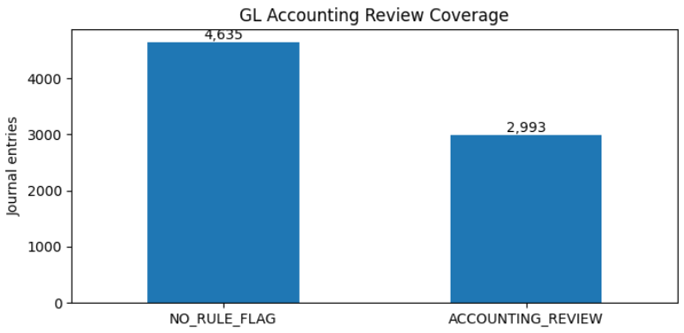
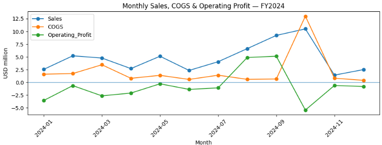
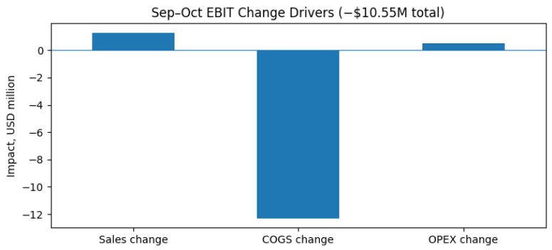
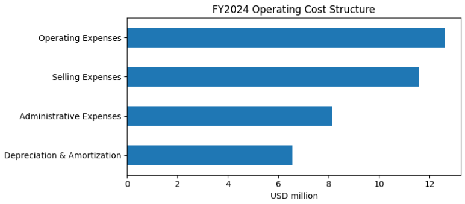
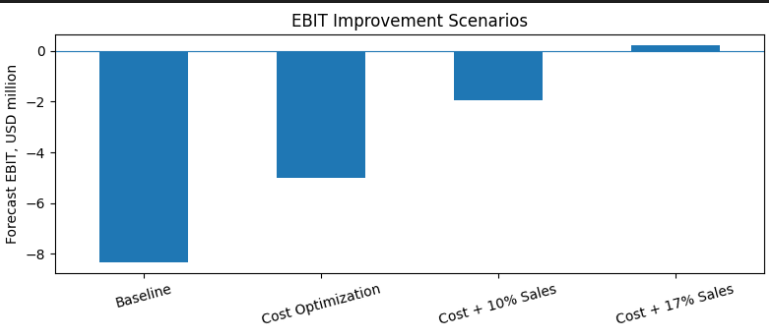

# Retail Financial Accounting & FP&A | FY2024

**End-to-End ERP Data Processing, Accounting Reconciliation, Financial Reporting & Business Performance Analysis**

**Tools:** Python (Pandas, NumPy, Matplotlib), Jupyter Notebook  
**Scope:** US Retail Company | FY2024 | USD  
**Focus:** Financial Accounting, Data Analytics, Financial Planning & Analysis

---

## 1. Project Overview

### Business Objective

This project develops an end-to-end financial accounting and FP&A workflow using raw ERP transaction data from a retail company.

The objective is to transform fragmented accounting records into reliable financial information, reconstruct financial statements, identify key profitability drivers, and develop actionable recommendations to improve operating performance.

### Project Workflow

**ERP Data Extraction → Data Cleaning & Validation → AP/AR/Inventory Reconciliation → General Ledger Audit → Trial Balance → Year-End Closing → Financial Statements → FP&A Analysis → Business Recommendations**

### Key Project Results

| Metric | Result |
|---|---:|
| Raw GL Transactions | 81,839 lines |
| Original Journal Entries | 7,669 |
| Cleaned GL Transactions | 80,919 lines |
| Final Journal Entries | 7,628 |
| Accounts Analyzed | 2,097 |
| Balanced Trial Balance | $214.87M |
| Automated Closing Entries | 1,150 |
| Financial Reconciliation Tests | 9/9 Passed |
| FY2024 Net Sales | $57.15M |
| FY2024 Operating Loss | ($8.31M) |
| FY2024 Net Loss | ($0.84M) |

---

## 2. Phase 0 — Data Extraction & ERP Data Modeling

### Objective

Extract and integrate raw accounting data into a structured financial database suitable for reconciliation, reporting, and analysis.

### Implementation

- Imported ERP JSON datasets containing General Ledger entries, Journal Headers, Chart of Accounts, AP/AR transactions, payment records, and inventory data.
- Standardized account codes, transaction identifiers, posting dates, amounts, and business processes.
- Established relationships across datasets using `document_id`, `account_code`, and transaction-level information.
- Built reusable Pandas DataFrames for accounting validation and financial analysis.

### Outcome

Developed an integrated accounting dataset supporting the **Procure-to-Pay (P2P), Order-to-Cash (O2C), Record-to-Report (R2R), and other ERP processes**.

---

## 3. Phase 1 — Data Cleaning & Accounting Validation

### Objective

Identify data quality issues and ensure transaction-level accounting consistency before financial reporting.

### Key Activities

- Validated 81,839 General Ledger lines across 7,669 Journal Entries.
- Matched GL account codes against the Chart of Accounts.
- Checked debit-credit equality, document identifiers, duplicate entries, negative amounts, and zero-value postings.
- Developed automated accounting validation rules using Python.

### Data Quality Results

| Issue | Finding | Action |
|---|---:|---|
| Unmapped COA | 40 JEs / 80 lines | Excluded from analytical GL |
| Zero-value postings | 840 lines | Removed |
| Negative posting | 1 credit of ($0.03) | Normalized |
| Unbalanced Journal Entries | 0 | Passed |
| Duplicate JE structures detected | 0 | Passed |

### Outcome

Created a structured and validated General Ledger dataset for subsequent reconciliation and financial reporting.

---

## 4. Phase 2 — Financial Accounting Reconciliation

### Objective

Reconcile subsidiary accounting records with GL postings to evaluate transaction completeness and financial accuracy.

### 4.1 Accounts Payable Reconciliation

- Matched 25 vendor invoices with 28 payment allocation records.
- Reconciled invoice values and payment transactions against AP control-account postings.
- Verified matched payment amounts and identified differences in subsidiary ledger status.

**Total AP payments reconciled: $12,139,913.89**

### 4.2 Accounts Receivable Reconciliation

- Reconciled 15 customer invoices with 17 receipt allocations.
- Validated invoice values, customer receipts, and GL postings.
- Compared subsidiary ledger payment statuses against recorded cash collections.

**Total AR receipts reconciled: $3,508,345.29**

### 4.3 Inventory Reconciliation

- Validated quantities and valuation information for 100 inventory materials.
- Analyzed Inventory GL debits, credits, and annual movements.
- Constructed an inventory roll-forward using the project’s opening inventory assumption.

| Inventory Metric | USD |
|---|---:|
| Opening Inventory (Assumed) | 123,799,995.61 |
| Net Inventory Movement | 17,530,057.45 |
| Closing Inventory (Calculated) | 141,330,053.06 |

### Outcome

Established transaction-level reconciliation procedures connecting AP, AR, and inventory records to General Ledger accounting.

---

## 5. Phase 3 — General Ledger Audit & Trial Balance

### Objective

Build an accounting control framework to identify unusual postings and prepare a balanced Trial Balance.

### Implementation

- Reconstructed the General Ledger from cleaned transaction data.
- Automated debit-credit verification at both Journal Entry and account levels.
- Developed rule-based controls using document types, accounting processes, and account classifications.
- Flagged journal entries with unusual relationships between Revenue, Expense, Assets, and Liabilities.

### Results

| GL Audit Metric | Result |
|---|---:|
| Final Journal Entries | 7,628 |
| Final GL Lines | 80,919 |
| Accounts | 2,097 |
| Total Debit | $214,867,992.50 |
| Total Credit | $214,867,992.50 |
| Debit-Credit Difference | $0 |
| Journal Entries Flagged for Review | 2,993 |

**Chart 1 — GL Accounting Review Coverage**

### Outcome

Developed a balanced Trial Balance and an automated exception-detection framework to support financial accounting controls.

---

## 6. Phase 4 — Year-End Closing & Financial Accounting

### Objective

Perform year-end accounting procedures and determine the company's financial result.

### Implementation

- Identified 1,149 Revenue and Expense accounts.
- Created automated year-end closing entries.
- Transferred temporary account balances to Income Summary.
- Closed Income Summary to Retained Earnings.
- Verified account balances after closing.

### Results

| Closing Control | Result |
|---|---:|
| P&L Accounts | 1,149 |
| Closing Journal Entries | 1,150 |
| Unbalanced Closing Entries | 0 |
| Unclosed P&L Accounts | 0 |
| Income Summary Ending Balance | $0 |
| FY2024 Net Loss | ($835,228.51) |

### Outcome

Automated the accounting closing process and established the financial result used in year-end reporting.

---

## 7. Phase 5 — Financial Statement Preparation

### Objective

Transform the reconciled General Ledger into financial statements and validate the consistency of financial information.

### 7.1 Income Statement

| FY2024 Financial Results | USD |
|---|---:|
| Net Sales | 57,146,983.65 |
| Cost of Goods Sold | (26,585,095.61) |
| **Gross Profit** | **30,561,888.04** |
| Gross Profit Margin | **53.48%** |
| Operating Expenses (Including D&A) | (38,874,085.30) |
| **Operating Profit** | **(8,312,197.26)** |
| Operating Profit Margin | **-14.55%** |
| Interest Income & Other Income | 15,301,983.11 |
| Interest Expenses & Other Expenses | (4,995,983.49) |
| Profit Before Tax | 1,993,802.36 |
| Tax-related Expenses | (2,829,030.87) |
| **Net Profit / Loss** | **(835,228.51)** |
| Net Profit Margin | **-1.46%** |

### 7.2 Balance Sheet & Cash Flow Analysis

Constructed a working Balance Sheet, inventory roll-forward, and Cash Flow movement statement from GL postings.

Key results:

- Provisional Assets: $221.95M.
- Provisional Liabilities: $98.98M.
- Calculated Closing Inventory: $141.33M.
- Net Cash Movement: +$2.08M.
- Unclassified Cash Inflows: $10.04M.

### 7.3 Financial Statement Reconciliation

Automated nine reconciliation controls covering:

- GL debit-credit balance.
- Income Statement and closing entries.
- Net Profit and Retained Earnings transfer.
- Post-closing temporary account balances.
- Balance Sheet arithmetic.
- Inventory roll-forward.
- Cash Flow and GL cash movements.

**Result: 9/9 Financial Reconciliation Controls Passed.**

---

## 8. Phase 6 — FP&A & Financial Performance Analysis

### Objective

Apply financial accounting outputs to evaluate profitability, operating efficiency, cash flow performance, and potential improvement strategies.

### 8.1 Financial KPI Analysis

Developed a Python-based financial KPI framework covering:

- Profitability: Gross Margin, EBIT Margin, EBITDA Margin, Net Margin.
- Cost Efficiency: COGS Ratio, OPEX Ratio, Selling Expense Ratio, Administrative Expense Ratio.
- Revenue Analysis: Product/Service Revenue Mix and Monthly Sales Growth.
- Working Capital: Inventory Turnover and DIO scenarios.
- Cash Flow: CFO, CFI, CFF, Cash Movements, and Classification Coverage.

### Key Findings

| Financial KPI | FY2024 |
|---|---:|
| Gross Profit Margin | 53.48% |
| EBITDA Proxy | ($1.76M) |
| EBITDA Margin | -3.08% |
| Operating Profit Margin | -14.55% |
| Net Profit Margin | -1.46% |
| COGS / Net Sales | 46.52% |
| OPEX / Net Sales | 68.02% |
| Inventory Turnover (Scenario) | 0.20x |

**Finding:** Despite a 53.48% Gross Margin, the business recorded an $8.31M operating loss because operating expenses exceeded Gross Profit.

### 8.2 Monthly Profitability & Variance Analysis

Analyzed 12 months of Revenue, COGS, Gross Profit, OPEX, and Operating Profit to identify unusual fluctuations and major earnings drivers.

**Chart 2 — Monthly Sales, COGS & Operating Profit (FY2024)**

#### September–October Profitability Investigation

| Metric | September | October |
|---|---:|---:|
| Net Sales | $9.22M | $10.50M |
| COGS | $0.68M | $12.99M |
| Gross Margin | 92.7% | -23.7% |
| Operating Profit | +$5.14M | -$5.41M |

Developed an EBIT bridge to isolate the impact of Revenue, COGS, and OPEX changes.

| EBIT Driver | Impact |
|---|---:|
| Revenue Change | +$1.28M |
| COGS Change | -$12.31M |
| OPEX Change | +$0.48M |
| **Total EBIT Change** | **-$10.55M** |

**Chart 3 — September-to-October EBIT Driver Bridge**

### 8.3 Transaction-Level Root Cause Analysis

Traced October's $12.99M COGS to individual accounts, document types, and Journal Entries.

**Three Journal Entries accounted for $11.95M, representing 91.97% of October COGS.**

Key findings:

- A $6.33M journal recorded equal Revenue and COGS, resulting in zero Gross Profit contribution.
- A $4.78M COGS posting was recorded alongside Fixed Assets and Short-Term Debt.
- A separate $0.84M journal recorded equal Revenue and COGS.

This analysis demonstrated how transaction-level investigation can explain unusual financial results more effectively than aggregate ratios alone.

### 8.4 Operating Expense Analysis

Analyzed annual OPEX of $38.87M by category, month, account, and individual Journal Entry.

| Expense Category | FY2024 | Share of OPEX |
|---|---:|---:|
| Operating Expenses | $12.61M | 32.44% |
| Selling Expenses | $11.57M | 29.75% |
| Administrative Expenses | $8.14M | 20.95% |
| Depreciation & Amortization | $6.55M | 16.85% |
| **Total OPEX** | **$38.87M** | **100%** |

**Chart 4 — FY2024 Operating Expense Breakdown**

The results indicated that Selling, Administrative, and Operating Expenses represented the largest areas for controllable cost optimization.

### 8.5 Financial Scenario & Sensitivity Analysis

Built an EBIT sensitivity model to evaluate the combined impact of Revenue Growth and Operating Cost Reduction.

The proposed cost optimization assumptions were:

- Selling Expenses: -10%.
- Operating Expenses: -12%.
- Administrative Expenses: -8%.

**Estimated annual OPEX savings: $3.32M.**

| Strategy | EBIT Improvement | Forecast EBIT |
|---|---:|---:|
| Baseline | $0 | ($8.31M) |
| Cost Optimization | +$3.32M | ($4.99M) |
| Cost Optimization + 10% Sales Growth | +$6.38M | ($1.93M) |
| Cost Optimization + 17% Sales Growth | +$8.52M | +$0.21M |

**Chart 5 — EBIT Improvement Scenarios**

Under the modeled assumptions, the business would require approximately **$9.33M in additional sales (+16.33%)** after cost optimization to reach operating break-even.

---

## 9. Business Recommendations

Based on the accounting reconciliation and FP&A results, four strategic priorities were identified.

### Recommendation 1 — Strengthen Accounting & COGS Controls

Implement transaction-level reconciliation between Revenue, Inventory, and COGS, especially for large manual or unusual journal postings.

**Expected benefit:** More consistent cost recognition, reliable Gross Margin reporting, and stronger month-end financial controls.

### Recommendation 2 — Optimize Operating Expenses

Prioritize Selling, Operating, and Administrative Expenses through account-level cost reviews, supplier evaluation, and expense monitoring.

**Financial target:** $3.32M in annual OPEX savings under the cost optimization scenario.

### Recommendation 3 — Focus on Profitable Revenue Growth

Prioritize sales growth supported by Gross Margin and Contribution Margin rather than Revenue volume alone.

Combine operating cost efficiency with targeted sales expansion.

**Financial target:** Approximately 16–17% incremental sales growth alongside planned cost savings to achieve operating break-even under the modeled assumptions.

### Recommendation 4 — Improve Working Capital & Cash Flow Visibility

Strengthen AP/AR reconciliation, cash-flow classification, and inventory monitoring.

Use integrated accounting dashboards to track cash conversion, liquidity, working capital, and financial performance.

**Expected benefit:** Better financial visibility and more effective cash-flow planning.

---

## 10. Key Skills Demonstrated

| Area | Skills Applied |
|---|---|
| Data Analytics | Python, Pandas, NumPy, Data Cleaning, Data Transformation |
| Financial Accounting | GL, Journal Entries, Trial Balance, AP/AR Reconciliation |
| Accounting Controls | COA Mapping, JE Validation, GL Audit, Exception Detection |
| Financial Reporting | Income Statement, Working Balance Sheet, Cash Flow, Year-End Closing |
| FP&A | KPI Analysis, Monthly Performance, EBIT Bridge, Cost Analysis |
| Decision Support | Root Cause Analysis, Scenario Modeling, Sensitivity Analysis |

---

## 11. Project Conclusion

This project demonstrates the integration of **Financial Accounting, Data Analytics, and FP&A** in an end-to-end financial management workflow.

Using Python, raw ERP transactions were transformed into structured accounting information, reconciled across financial processes, and converted into year-end reporting outputs.

The financial analysis identified an **$8.31M operating loss**, traced **91.97% of October COGS to three Journal Entries**, and developed a financial improvement scenario combining **$3.32M in operating cost savings with targeted revenue growth**.

The project highlights how accounting data can be used not only for recording and reporting transactions, but also for **explaining business performance, identifying financial risks, and supporting management decisions**.

